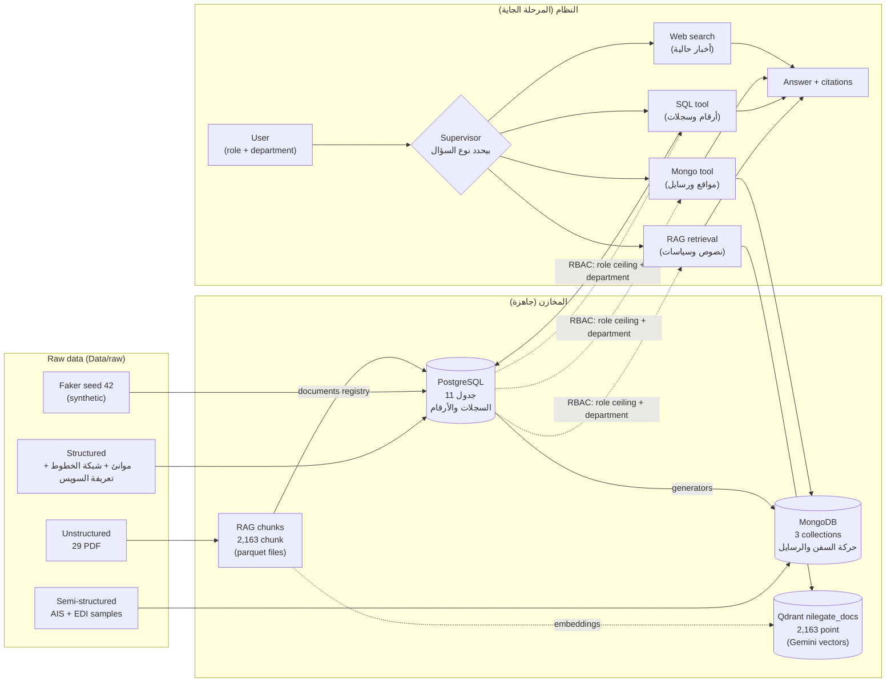
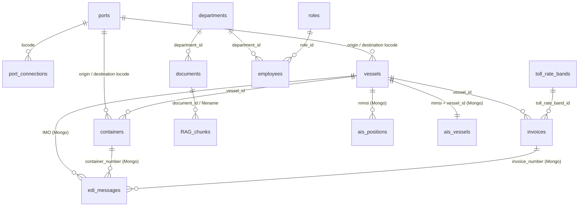
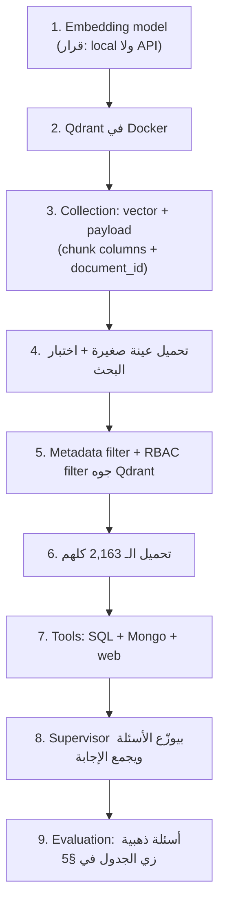

# Data Map — كل الداتا اللي معانا، بتخدم إيه، ومربوطة ببعض إزاي

الملف ده مرجع لتصميم الـ **RAG workflow**. كل الأرقام متحققة يوم 2026-09-27؛ جزء Qdrant والـ retrieval اتحدّث يوم 2026-10-08 (قفل خطة الـ RAG).
(الرسومات مكتوبة بـ Mermaid: بتتعرض في VS Code عن طريق Markdown Preview، وعلى GitHub.)

---

## 1. الصورة الكاملة في رسمة واحدة



**الفكرة في جملة:**
- **النصوص** (PDFs) بتتسأل بالـ **RAG**.
- **الأرقام والسجلات** بتتسأل بـ **SQL** على PostgreSQL.
- **الحركة والرسايل** بتتسأل بـ **Mongo**.
- **الأخبار** بتتسأل بـ **web search**.
- الـ Supervisor بيختار الطريق، ولو السؤال محتاج أكتر من مصدر بيجمعهم.

---

## 2. أنواع الداتا بالتفصيل

### 2.1 Structured, حقيقية → PostgreSQL

| الجدول | العدد | إيه هو | بيخدم إيه |
|---|---:|---|---|
| `ports` | 837 | موانئ حقيقية بالـ UN/LOCODE والإحداثيات | المرجع الجغرافي: كل ميناء في المشروع بيتعرف بالكود ده |
| `port_connections` | 19,990 | الخطوط بين الموانئ وحجم الحركة | شبكة الملاحة: منها اتولدت مسارات السفن |
| `toll_rate_bands` | 177 | تعريفة رسوم قناة السويس (شرايح تصاعدية) | حساب الرسوم وشرح الفواتير |

### 2.2 Synthetic، شركة NileGate → PostgreSQL

| الجدول | العدد | إيه هو | بيخدم إيه |
|---|---:|---|---|
| `departments` | 5 | Operations، Customs، Finance، HR، IT | صلاحيات القسم (RBAC) |
| `roles` | 3 | employee (1)، manager (2)، ceo (3) | سقف الـ sensitivity اللي كل role يقدر يشوفه |
| `employees` | 100 | الموظفين (فيهم بيانات شخصية) | **مين بيسأل** وإيه اللي مسموحله يشوفه |
| `vessels` | 500 | أسطول الشركة (IMO، MMSI، النوع، الحالة، الرحلة) | **مرجع هوية السفينة** لكل حاجة تانية |
| `containers` | 1,000 | الحاويات على السفن | الشحنات |
| `invoices` | 1,000 | فواتير رسوم عبور السويس (2025) | الأسئلة المالية |
| `documents` | 29 | سجل ملفات الـ RAG | الربط بين كل chunk ومصدره |

### 2.3 Semi-structured → MongoDB

| Collection | العدد | إيه هو | بيخدم إيه |
|---|---:|---|---|
| `ais_positions` | 1,321,568 | مواقع السفن بالوقت (time-series) | "السفينة X فين؟"، "مين راسي جنب ميناء Y؟"، سرعات ورحلات |
| `ais_vessels` | 10,534 | بيانات السفن زي ما بتبعتها (الاسم، النوع، الوجهة، الـ ETA) | تعريف السفن الحقيقية + سفننا |
| `edi_messages` | 435 | رسايل تعليمات الشحن IFTMIN (الأصلية + المحللة)، مربوطة بالسفينة والحاويات والفاتورة | "إيه الـ containers اللي على رحلة Z؟"، "الفاتورة دي تبع أنهي شحنة؟" |

داتا حقيقية (10,949 موقع و10,034 سفينة) = **مرجع للمقارنة بس، ومش مربوطة بشركتنا**.
داتا synthetic (500 سفينة، 434 رسالة) = **سفننا نفسها**، ومربوطة بـ PostgreSQL.

### 2.4 Unstructured → RAG chunks → Qdrant (`nilegate_docs`، متحمّلة يوم 2026-10-08)

| المصدر | chunks | القسم / المستوى | بيجاوب على إيه |
|---|---:|---|---|
| FIATA FBL template | 31 | Operations / 1 | مفاهيم بوليصة الشحن متعددة الوسائط |
| LPI Methodology (البنك الدولي) | 94 | Operations / 1 | مؤشرات أداء اللوجستيات بتتقاس إزاي |
| LPI Connecting to Compete 2025 | 69 | Operations / 1 | نتايج 2023–24، مقارنة الدول، السياسات |
| Suez Canal Notes | 4 | Finance / 1 | قواعد تطبيق التعريفة (تكملة لجدول `toll_rate_bands`) |
| HbR Annual Report 2025 | 352 | Operations / 1 + **Finance / 3 (5 chunks)** | الاستراتيجية، الـ ESG، الحوكمة + **النتايج المالية (CEO بس)** |
| IMO casualty-reporting circular | 69 | Operations / 1 | إيه اللي لازم يتبلّغ في الحوادث البحرية، والأكواد |
| 23 تقرير USCG | 1,544 | Operations / 1 | حوادث حقيقية: إيه اللي حصل، ليه، والتوصيات |
| **المجموع** | **2,163** | | |

كل chunk = point واحد في Qdrant: vector من Gemini `gemini-embedding-2` (3,072 بُعد) لـ `title + text` (ADR-037، ADR-041)،
والـ payload = الـ 16 عمود + `document_id`. البحث بيمر من `search_documents` (`pipelines/lib/retrieval.py`): فلتر الـ RBAC
جوه Qdrant، exact dense، وبعدين Jina rerank (ADR-038). المستندات اللي الموظف بيرفعها في المحادثة بتتخزن في الذاكرة بس
وبتتبحث بموديل محلي (`bge-m3`) في قايمة منفصلة اسمها `session_results` (ADR-042 – ADR-044).

### 2.5 Live

| المصدر | بيخدم إيه |
|---|---|
| Web search | الأخبار والأحداث الحالية. **مش** جزء من الـ corpus (ADR-011) |

---

## 3. الداتا مربوطة ببعض إزاي (المفاتيح)



| المفتاح | بيربط إيه |
|---|---|
| **UN/LOCODE** (5 حروف، زي `EGALY`) | الموانئ ↔ الخطوط ↔ السفن ↔ الحاويات ↔ رسايل EDI ↔ وجهات AIS |
| **vessel_id / IMO / MMSI** | السفينة في PostgreSQL ↔ مواقعها في Mongo (MMSI) ↔ رسايلها (IMO) ↔ فواتيرها |
| **container_number** | الحاوية في PostgreSQL ↔ رسالة الـ EDI اللي بتعلن عنها |
| **invoice_number** | فاتورة رسوم السويس في PostgreSQL ↔ رسالة الـ EDI بتاعة نفس السفينة (`RFF+IV`، 376 رسالة) |
| **vessel_type = vessel_category** | السفينة ↔ شرايح التعريفة بتاعتها |
| **department + sensitivity_level** | أساس الـ RBAC: موجودين كأعمدة على كل chunk وكل document في Mongo؛ أما جداول PostgreSQL فمستوى كل جدول مكتوب في `docs/rbac_mapping.md` §2 |
| **document_id** | كل chunk وكل point في Qdrant ↔ الملف الأصلي في جدول `documents` (point id = UUID5 من `document_id` + `chunk_id`، ADR-039) |

---

## 4. مين يقدر يشوف إيه (RBAC)

```
مسموح = مستوى المورد ≤ سقف الـ role
     أو (المورد تبع قسم المستخدم  و  المستوى ≤ 2)
المستوى 3 = CEO بس، مفيش قسم بيفتحه
```

| المستوى | مين يشوف | أمثلة |
|---|---|---|
| **1** | الكل | الموانئ، السفن، الحاويات، AIS، EDI، كل الـ PDFs تقريباً |
| **2** | managers + CEO + موظفي القسم صاحب المورد | `invoices` (Finance)، `employees` (HR)، `roles` (IT) |
| **3** | CEO بس | النتايج المالية في تقرير HbR (5 chunks) |

**مهم لتصميم الـ RAG:** الفلتر لازم يتطبق **على مستوى الـ chunk**، مش الملف، لإن ملف HbR فيه مستويين. والفلتر لازم يتطبق **جوه البحث في Qdrant**، مش بعد ما النتايج ترجع.

---

## 5. أمثلة أسئلة: السؤال بيروح فين

| السؤال | النوع | المصادر |
|---|---|---|
| "إيه قواعد حساب رسوم السويس لناقلات البترول؟" | نص | RAG: Suez Notes + SQL: `toll_rate_bands` |
| "ليه فاتورة السفينة X طلعت بالمبلغ ده؟" | أرقام + شرح | SQL: `invoices` + `toll_rate_bands` + `vessels`، ثم RAG: Suez Notes للقواعد |
| "السفينة X فين دلوقتي ورايحة فين؟" | حركة | Mongo: `ais_positions` + `ais_vessels` + SQL: `vessels` |
| "إيه الحاويات اللي على رحلة السفينة X؟" | رسايل + سجلات | Mongo: `edi_messages` + SQL: `containers` |
| "الفاتورة INV-0000923 تبع أنهي شحنة وإيه شريحة التعريفة بتاعتها؟" | flow كامل | Mongo: `edi_messages` (invoice_number) → SQL: `invoices` + `toll_rate_bands` + RAG: Suez Notes |
| "إيه المطلوب تبليغه لو حصل حريق على سفينة؟" | نص | RAG: IMO circular + تقارير USCG عن حرايق مشابهة |
| "إيه أسباب حوادث السقوط من السفن وإيه التوصيات؟" | نص | RAG: تقارير USCG (incident profiles + findings) |
| "أداء مصر اللوجستي مقارنة بغيرها؟" | نص | RAG: LPI 2025 + LPI Methodology |
| "إيه صافي أرباح ميناء روتردام 2025؟" | نص محمي | RAG: HbR، **مستوى 3، CEO بس** |
| "إيه آخر أخبار قناة السويس؟" | حالي | Web search |
| "كام سفينة راسية جنب الإسكندرية؟" | حركة | Mongo: geo query على `ais_positions` |

---

## 6. اللي جاهز واللي لسه

| الحاجة | الحالة |
|---|---|
| PostgreSQL (11 جدول، constraints، comments، read-only role) | ✅ جاهز |
| MongoDB (3 collections، validated، audited) | ✅ جاهز |
| RAG chunks (2,163) + جدول `documents` (29، `ingested_at` متملي بـ migration 011) | ✅ جاهز |
| Embedding model (Gemini) + Qdrant `nilegate_docs` + `search_documents` | ✅ جاهز (2026-10-08، ADR-037 – ADR-039) |
| RBAC filter جوه الـ retrieval | ✅ جاهز: جوه كل prefetch في Qdrant، 88 بحث في الاختبار، تسريب 0 |
| Evaluation (golden set: 40 إنجليزي + 24 عامية مصرية) | ✅ جاهز: dense + rerank = 0.850 (ADR-038، ADR-040) |
| مستندات بتترفع وقت المحادثة | ✅ جاهز كـ library (ADR-042 – ADR-044) |
| Supervisor + tools (SQL / Mongo / web) | ⏳ المرحلة الجاية (agents) |

---

## 7. ترتيب بناء الـ RAG workflow (الخطوات 1–6 و9 اتنفذت لجزء المستندات يوم 2026-10-08؛ 7–8 مع الـ agents)


