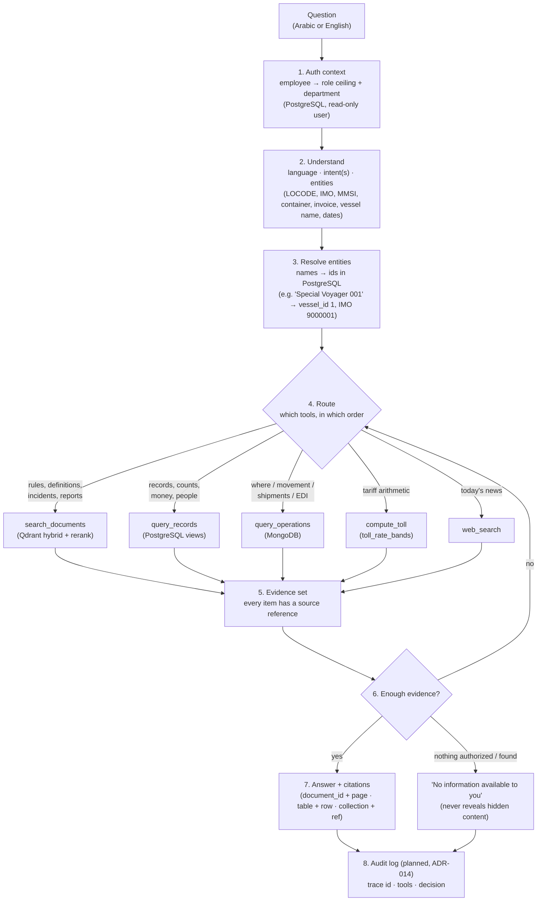
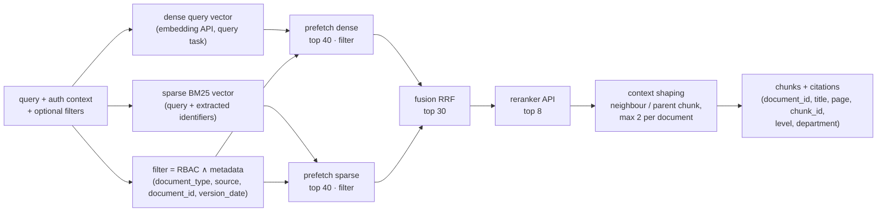

# Retrieval flow — how a question travels through the NileGate system

Design reference for the RAG phase (`docs/plans/RAG_Embeddings_Qdrant_plan.md`) and the agents phase after it.
Status: **PROPOSED** (2026-09-28). Research sources are listed at the end.

The **Supervisor agent** owns the answer. It never reads a store directly: it calls **tools**, and every tool applies the
user's access rights **inside** its query (ADR-006). This plan builds the document tool; the other tools reuse the same
authorization context and are built in the agents phase.

---

## 1. The whole flow

**Rules for every tool**
- The authorization context (role ceiling, department) comes from PostgreSQL, never from the question text.
- RBAC is a **predicate inside the query**: a Qdrant filter, a SQL `WHERE`, or a Mongo filter. It is never applied
  to results after they come back.
- Level 3 is never unlocked by department (ADR-006).
- "Not authorized" and "does not exist" get **the same answer**, so hidden content never leaks through a refusal.
- Every piece of evidence carries its reference; no answer is given without one.
- Retrieved text is **data, not instructions** (the project rules rule 5).

---

## 2. The document tool in detail (built in this plan)

| Step | Why | Can be switched off for evaluation |
|---|---|---|
| Dense vector | meaning, synonyms, Arabic ↔ English | never |
| Sparse BM25 | exact tokens the dense model blurs: `MSC-MEPC.3/Circ.4/Rev.1`, LOCODEs, MISLE numbers, vessel names | `hybrid=False` |
| RBAC ∧ metadata filter in **both** prefetches | a hidden chunk never enters the candidate lists | never |
| RRF fusion | dense and BM25 scores are on different scales; RRF uses only the ranks | — |
| Reranker | reads the query and the chunk together; usually fixes the order of the top candidates | `rerank=False` |
| Context shaping | a finding without its section, or a table row without its header, is weaker; also avoids 8 chunks from one report | `expand=False` |

The Phase 7 evaluation compares **dense only / hybrid / hybrid + rerank** on the golden set. The default setting is the
one the numbers support.

---

## 3. Question types → tools

| # | Question type | Example | Tools (in order) |
|---|---|---|---|
| 1 | Definition / procedure / rule | "What must be reported after a fire on board?" | `search_documents` (IMO circular, USCG) |
| 2 | Incident analysis | "Common causes of falls overboard and the recommendations" | `search_documents` (USCG, filter `document_type`) |
| 3 | Benchmarks / policy | "How does Egypt's logistics performance compare?" | `search_documents` (LPI) |
| 4 | Company records | "How many containers does vessel X carry?" | `query_records` |
| 5 | Money | "Why is invoice INV-0000923 this amount?" | `query_records` (invoice, band) → `compute_toll` → `search_documents` (Suez Notes rules) |
| 6 | Operations now | "Where is vessel X and when does it arrive?" | resolve vessel → `query_operations` (latest fix, ETA) |
| 7 | Shipment chain | "Which shipment is invoice X for, and which containers are in it?" | `query_operations` (EDI by `invoice_number`) → `query_records` (containers, vessel) |
| 8 | Geography | "Which vessels are anchored near Alexandria?" | resolve LOCODE → `query_operations` (geo filter + NAVSTAT 1) |
| 9 | Protected | "Rotterdam's 2025 net result?" | `search_documents`: the level-3 chunks go to the CEO only; everyone else gets "not available to you" |
| 10 | News | "Latest news on the Suez Canal?" | `web_search` (not the corpus, ADR-011) |
| 11 | Mixed | "Is vessel X late against its ETA, and what does the tariff charge for its category?" | `query_operations` + `query_records` + `compute_toll` |

---

## 4. Shared identifiers for routing and resolution

UN/LOCODE, `vessel_id` / IMO / MMSI, `container_number`, `invoice_number` and `document_id` (the full map is in
`docs/DATA_MAP.md` §3). The "resolve entities" step turns names into these ids **before** any tool is called, so
every tool is queried by id and never by fuzzy text.

---

## 5. Chosen stack (research of 2026-09-28; decisions D1–D4 in the plan)

| Need | Choice | Why | Alternatives kept |
|---|---|---|---|
| Vector database | **Qdrant** (already ADR-001), Docker | dense + sparse named vectors in one collection; hybrid via Query API `prefetch` + RRF / DBSF fusion; payload filters inside each prefetch; filterable HNSW with payload indexes; multi-stage rescoring; light, one container | Weaviate (BM25 hybrid, heavier); Milvus (native BM25, needs etcd / MinIO); pgvector (inside our PostgreSQL, but no clean native hybrid) |
| Embeddings (API, free) | **Jina `jina-embeddings-v5-text-small`** (1,024 dims, 32K context, Qwen3 backbone, Arabic covered; free key 100 RPM / 100K TPM) | multilingual incl. Arabic; one key also covers the reranker; the corpus (~0.35 M tokens) fits in the free tokens | **Voyage `voyage-4`** (200 M free tokens; Arabic not listed explicitly); **Gemini `gemini-embedding-2`** (free, but free-tier data is used to improve Google products). Bake-off in Phase 2 |
| Reranker (API, free) | **Jina `jina-reranker-v3.5`** (multilingual listwise; free key 100 RPM) | same key, long context | **Voyage `rerank-3`** (200 M free tokens). Cohere dropped: its trial key allows 1,000 calls a month and 10 rerank requests a minute |
| Sparse / BM25 | Qdrant BM25 (server-side inference if the pinned version has it, otherwise `fastembed` `Qdrant/bm25` on the client; `onnxruntime` is already installed) | exact identifiers | — |
| HTTP | `httpx` for every embedding / rerank API | one client, retries and rate limits in one place, no vendor SDK lock-in | vendor SDKs |

**Uncertain (checked during the plan):**
- the exact number of free tokens on a new Jina key;
- Voyage's rate limits without a payment method, and its Arabic coverage;
- server-side BM25 in the pinned Qdrant version.

Sending data to an API is acceptable here: the corpus is public reports plus synthetic company data (the level-3 HbR
chunks come from a public annual report), and employee personal data is never embedded.

---

Sources: [MTEB leaderboard overview (Modal)](https://modal.com/blog/mteb-leaderboard-article) ·
[Embedding models 2026 benchmark (Tensoria)](https://tensoria.fr/en/blog/embedding-models-2026-guide) ·
[Free embedding APIs 2026 (Eden AI)](https://www.edenai.co/post/top-free-embedding-tools-apis-and-open-source-models) ·
[Jina embeddings](https://jina.ai/embeddings/) · [Jina reranker](https://jina.ai/reranker/) ·
[Voyage pricing](https://docs.voyageai.com/docs/pricing) · [Voyage embeddings](https://docs.voyageai.com/docs/embeddings) ·
[Gemini API pricing](https://ai.google.dev/gemini-api/docs/pricing) · [Cohere rate limits](https://docs.cohere.com/docs/rate-limits) ·
[Qdrant hybrid queries](https://qdrant.tech/documentation/search/hybrid-queries/) · [Qdrant hybrid search article](https://qdrant.tech/articles/hybrid-search/) ·
[Vector databases 2026 (Firecrawl)](https://www.firecrawl.dev/blog/best-vector-databases) ·
[Vector DBs for agents 2026 (DEV)](https://dev.to/agdex_ai/top-vector-databases-for-ai-agents-in-2026-qdrant-vs-pinecone-vs-weaviate-vs-pgvector-vs-milvus-4ng2)
