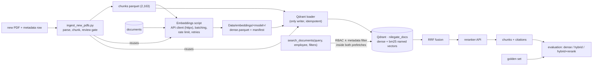

# Plan — RAG retrieval: embeddings (API), Qdrant hybrid search, RBAC, reranking, evaluation

- **Status:** APPROVED (2026-09-28), decisions D1–D8 answered by the owner (§4, "Answers"). **Rewritten 2026-10-01**
  as a fresh start: every phase is a script (ADR-036), the work runs **on the owner's machine** (not a cloud session),
  nothing of Phase 0 counts as done, and a new Phase 8 adds the **PDF ingestion script** for future documents of the
  RAG corpus (moved here from `docs/archive/2026-10-01_Scripts_and_ingestion_plan.md` part B, owner decisions D5–D6 of that plan).
  The rewrite needs the owner's confirmation at the start of Phase 0 (D9–D11 are new). Handoff: §"Progress / deviations"
  below, committed.
- **Goal:** turn the 2,163 reviewed chunks into a searchable, access-controlled **hybrid** index (dense + BM25) with an
  optional reranking stage, **prove with numbers** that the right chunks come back for the right user, and leave a
  one-shot script that takes any new PDF of the corpus through the same path (parse → chunk → register → embed → Qdrant). This builds
  the `search_documents` tool of `docs/RETRIEVAL_FLOW.md`; the Supervisor, the other tools and answer generation come
  in the agents phase.
- **Follows** the ROADMAP ingestion order: … → chunking ✅ → embedding model → Qdrant (local Docker) → collection → small
  controlled subset → retrieval test → metadata filtering → RBAC → scale → hybrid / reranking **measured, not assumed**.
- **Builds on:** ADR-001 (Qdrant), ADR-006 (RBAC rule), ADR-009 (payload = chunk columns + `document_id`), ADR-021
  (level per chunk), ADR-027 (container pattern), ADR-031 pattern (files first, one writer, idempotent), ADR-034
  (read-only PostgreSQL user), ADR-035 (`documents`).
- **Answers:** ARCHITECTURE §10 Q1 (embedding model).
- **Design reference:** `docs/RETRIEVAL_FLOW.md` (whole question flow, the document tool, question types → tools, stack research).

---

## 1. Starting point (verified 2026-09-28; pipelines are scripts since 2026-10-01)

| Input | State |
|---|---|
| Chunks `Data/processed/rag/chunks/*.parquet` | 7 files, 2,163 chunks, 16 columns, unique `chunk_id`; 0 empty / duplicate / over-2,000-char texts; median 649 chars (≈ 0.35 M tokens in total) |
| Access columns | `sensitivity_level` 1 (2,158) / 3 (5, HbR financial results, Finance); every `department` is a row of `departments` |
| `documents` (PostgreSQL) | 29 rows; chunk `filename` → `document_id` (basename unique) |
| RBAC data | `roles`, `employees`, `docs/rbac_mapping.md`; read-only login user (`PG_RO_*`) verified 8/8 |
| Infrastructure | `ports-postgres`, `ports-mongo` (127.0.0.1 only); no Qdrant yet; `Data/embeddings/` empty; `httpx` 0.28.1 and `qdrant-client` 1.19.1 already in `pyproject.toml` (to re-check in Phase 0) |
| API keys | `JINA_API_KEY`, `VOYAGE_API_KEY`, `GEMINI_API_KEY` to be in the owner's local `.env`; **no provider tested yet** |
| Code | the 7 per-source chunking scripts (`pipelines/scripts/rag/`) are the reference parsers for Phase 8 |
| Language | corpus in English; questions in Egyptian Arabic and English → cross-lingual retrieval is the main quality risk |

## 2. Target shape



- **Collection `nilegate_docs`:** one point per chunk, point id = UUID5(`chunk_id`) (idempotent). Named vectors:
  `dense` (model dimension, cosine) and `bm25` (sparse, IDF modifier). Both are created from the start, so hybrid never
  needs a rebuild.
- **Payload:** the 16 chunk columns + `document_id`. Payload indexes: `sensitivity_level` (integer); `department`,
  `document_id`, `document_type`, `source`, `real_or_synthetic` (keyword).
- **RBAC inside the query (ADR-006):** `sensitivity_level ≤ ceiling` OR (`department = user department` AND
  `sensitivity_level ≤ 2`), applied in **each** prefetch.
- **Files first:** dense vectors are computed once through the API into `Data/embeddings/` with a manifest (provider,
  model, version / date, dimension, task parameters, chunk hashes). Re-embedding happens only if the model or a chunk
  changes; the loader never calls the embedding API. This protects the free quota and keeps loads reproducible.

## 3. Phases

Every script follows `script-dev-loop` (ADR-036: percent-format cells, `tools/run.py`), a validation cell with a
reviewed snapshot per phase, and a Final Checkpoint (narrative in `pipelines/checkpoints/retrieval/`). New scripts go in
`pipelines/scripts/retrieval/`. Code that Phase 8 reuses (embedding client, Qdrant upsert, chunk schema check) is
written once in a small shared module `pipelines/lib/` (decision D11) instead of being copied. Everything runs on the
owner's machine; the assistant runs `uv` and the scripts there, the owner runs git and edits `.env` (D8).

### Phase 0 — Session start, keys, confirmation (local)
- Confirm the rewrite (D9–D11); the handoff lives in §"Progress / deviations" of this plan, committed.
- The owner adds the keys to `.env`: `JINA_API_KEY`, `VOYAGE_API_KEY`, `GEMINI_API_KEY` (accounts at the three
  providers) and `QDRANT_API_KEY` — **not an account**: a random secret the owner generates, which our own local
  container `ports-qdrant` requires on every request (passed as `QDRANT__SERVICE__API_KEY` when the container is
  created, like the MongoDB root password). The names are already in `.env.example`.
- `uv add` (pinned with `==`): `httpx`, `qdrant-client`; `fastembed` only if Phase 3 shows that server-side BM25 is
  not available in the pinned Qdrant.
- Smoke test per provider, script `pipelines/scripts/retrieval/Provider_smoke_test.py` (one tiny embed call per
  provider + one Jina rerank call, an English and an Egyptian Arabic sentence; prints status, dimension, latency and
  quota headers if any, **never the key**; a key value is redacted from any error text). All three must pass before
  Phase 1 starts. This also settles the UNCERTAIN points: the Jina free-token amount, Voyage limits without a card,
  Arabic behaviour.

### Phase 1 — Golden set first (before any model runs)
Script `Golden_set.py` → `Data/processed/rag/eval/golden_set.jsonl`.
- 40 English questions written from the chunks, each with its expected `chunk_id`s (1–3) and `document_id`; 24 of
  them also written in Egyptian Arabic with the same expected ids (**paired**, D7) → 64 queries (≈ 62 % / 38 %).
- Written as a user would ask (no copying of distinctive chunk phrases, except in identifier questions), and reviewed
  by the owner before the set is frozen (reviewed snapshot + file hash).
- Every source covered in proportion to its size; the question types of `docs/RETRIEVAL_FLOW.md` §3 (rows 1–3, 5, 9)
  are included.
- ≥ 6 **identifier questions** (circular number, MISLE number, vessel name, LOCODE), which test BM25.
- 8 **RBAC cases** on the level-3 HbR chunks, each paired with the users who must / must not see them.
- Validation: expected ids exist; coverage per source / language / type; no duplicates.

### Phase 2 — Embedding bake-off (APIs, no Qdrant)
Script `Embedding_bakeoff.py`.
- Candidates: Jina `jina-embeddings-v5-text-small`, Voyage `voyage-4`, Gemini `gemini-embedding-2`, each with its
  retrieval task parameters (query vs document).
- Embed all chunks + the golden questions once per candidate (≈ 0.35 M tokens each, within the free tiers). Rank by
  cosine similarity in NumPy.
- Compare recall@5 / recall@10 / MRR — overall, per language (Arabic vs English), per source — plus latency and
  failures.
- Also compare the embedded text: `text` vs `title + "\n\n" + text`.
- Output: the choice → **ADR-037**. The candidates' vectors are kept only as scratch (git-ignored).

### Phase 3 — Qdrant container
- Same pattern as `ports-mongo`: image pinned to an exact version + digest, container `ports-qdrant`, volume
  `ports-qdrant-data`, `127.0.0.1:6333` (REST) and `127.0.0.1:6334` (gRPC) only, API key from `.env`.
- `db/qdrant/README.md` with the commands.
- Probe script, output in `db/qdrant/audit/`: create a test collection with `dense` + `bm25` named vectors, payload
  indexes, a hybrid query with a filter in each prefetch + RRF, server-side BM25 availability; then delete the test
  collection.
- Negative checks: no API key → refused; LAN address → closed.

### Phase 4 — Embed all chunks with the chosen model (files)
Script `Embeddings.py` → `Data/embeddings/<model_slug>/dense.parquet` (`chunk_id`, vector, `text_sha256`) +
`manifest.json`.
- The client batches within the rate limits, retries on 429 / 5xx with backoff, and resumes from a partial file.
- Validation: 2,163 vectors, fixed dimension, finite values, `text_sha256` equals the chunk hash; a re-run skips
  every chunk already embedded (0 API calls).

### Phase 5 — Load Qdrant (the only writer)
Script `Qdrant_loader.py`.
- Verify the manifest against the chunk files; recreate `nilegate_docs`; build the BM25 vectors; upsert in batches.
- **Pilot first:** LPI Methodology (94 chunks), full checks; then all 2,163.
- **Reload and re-validate from Qdrant:** count; every payload equals its chunk row + `document_id`; sampled vectors
  equal the file; payload indexes present; a second load changes nothing.

### Phase 6 — `search_documents` + RBAC + metadata filters
Script `Retrieval.py`: `search_documents(query, employee_id, k=8, filters=None, hybrid=True, rerank=True)`.
- The role ceiling and department come from PostgreSQL through the read-only user.
- Two prefetches (dense, bm25), each with RBAC ∧ metadata filter → RRF → reranker (Jina `jina-reranker-v3.5`, or
  Voyage `rerank-3` per D2) → context shaping (at most 2 chunks per document, parent / neighbour option).
- Returns chunks + citations.
- **RBAC test matrix:** 3 roles × 5 departments × the level-3 questions. The level-3 chunks are returned to the CEO
  only; the filter is asserted to be part of the request (inspected request body), never a post-filter.

### Phase 7 — Evaluation
Script `Evaluation.py`.
- Compare **dense only / hybrid / hybrid + rerank / + context shaping** on the golden set and the golden facts with
  the three-level framework of ADR-040 (retrieval: fact recall@10; ranking: nDCG@10; context: sufficiency@8; balanced
  score), per source / language / type, identifier questions separately, latency. Deciding rule fixed in ADR-040.
- Error analysis of every miss.
- Default settings chosen by the numbers → **ADR-038** (collection, payload, RBAC filter, hybrid, rerank defaults).
- Results in `Data/processed/rag/eval/results_<date>.json`: the baseline the agents phase must not regress.

### Phase 8 — RE-SCOPED 2026-10-08 (owner): documents uploaded at inference time — PROPOSED, to design first
The owner's intent for Phase 8 is **not** (only) a batch script for new corpus PDFs, but: **an employee uploads a PDF
(or another document) while using the assistant; how does the system handle it?** The batch design below is kept as
reference (it holds the reusable steps: detect, extract / OCR, clean, chunk under the contract, embed, upsert), but
the next session starts by writing the inference-time design as PROPOSED and getting the owner's answers:
- **D12 Scope / lifetime:** ephemeral (the upload serves only that conversation / user, then expires) vs persistent
  (added to the shared corpus after review) vs both (ephemeral at once, promotion to the corpus through review).
- **D13 Access:** who can see an uploaded document's chunks (uploader only; uploader's department; a level chosen
  at upload) — must fit ADR-006, and an upload must never be able to widen anyone's access.
- **D14 Storage:** a separate Qdrant collection or `nilegate_docs` with an `upload` scope / `owner_employee_id` /
  `expires_at` payload; where the raw file lives (never `Data/raw/`); deletion on expiry.
- **D15 Processing at upload time:** latency budget (generic parse + OCR + chunk + embed while the user waits), size
  / page / type limits, the Gemini daily quota (ADR-037: ≈ 1,000-1,450 texts / day shared with queries), failure
  messages; the human review gate cannot sit inside an inference-time path → what replaces it.
- **D16 Safety:** uploaded text is untrusted data, never instructions (the project rules rule 5: prompt injection inside a
  PDF); malware / non-PDF content; personal data in uploads vs Gemini's free tier (ADR-037: never send non-public or
  personal data to the free tier) — this may require a different embedding path for uploads.
- **D17 Retrieval with uploads:** how `search_documents` merges the user's uploads with the corpus (same query,
  separate prefetch, boost), and how the golden-set baseline (ADR-038) is protected.

#### Owner answers (2026-10-08) — the design in the next session is built on these
- **D12 Scope / lifetime:** an upload serves **only the conversation it was uploaded in**. It may **join the corpus**
  only when it was uploaded **by a manager, for a specific department, and the manager explicitly asks** for it to be
  added (promotion is never automatic and never by an employee).
- **D13 Access:** an upload must **never widen anyone's access** (ADR-006 still decides who sees what), and it must be
  **free of any injection**: the uploaded text is checked and handled as untrusted data, never as instructions.
- **D14 Storage:** a promoted document is stored **exactly like its siblings** in the corpus (raw file, `documents`
  row, chunks under the contract, vectors, `nilegate_docs`). A conversation-only upload lives **at most in the
  session's cache / memory** (no raw-file archive, no corpus row, no shared collection), and disappears with it.
- **D15 Processing:** uploads happen **inside the company**, so NileGate defines **one fixed document shape that the
  whole company knows** (a template: structure, metadata block, headings, allowed content) to avoid problems at upload
  time; the system validates an upload against it. **We define this shape** (next session: specify it).
- **D16 Safety:** agreed as proposed — uploaded text is untrusted data (the project rules rule 5, prompt-injection
  screening); non-PDF / malicious content refused; personal or non-public data is never sent to Gemini's free tier
  (ADR-037), which may need a different embedding path for uploads.
- **D17 Retrieval with uploads:** agreed as proposed — `search_documents` merges the conversation's uploads with the
  corpus without lowering the golden-set baseline (ADR-038, `results_2026-10-08.json`); the concrete merge (separate
  prefetch / boost) is designed and measured next session.
- **Still to specify next session:** the company document shape (D15) and its validator; the injection screening
  method and its tests (D13 / D16); the embedding path for uploads that may hold non-public data (D16); the session
  store for conversation-only uploads (D14); the promotion flow for a manager (D12: request, review, registration
  through the normal path, migration by the owner); the merge in `search_documents` and its measurement (D17).

#### Former Phase 8 design (batch ingestion of new corpus PDFs; reference)
Script `pipelines/scripts/rag/ingest_new_pdfs.py` — a dedicated PDF agent (PDF only): a new PDF placed in
`Data/raw/unstructured/` goes all the way to Qdrant through the path proven above.
```text
new PDF + its metadata row (required)
  → detect new   : sha256 not in Data/processed/rag/documents.csv (a known file is skipped; a changed file = new version, ADR-035)
  → extract      : PyMuPDF text + layout; OCR (RapidOCR, ADR-025) only for image-only pages, with the OCR cache pattern
  → clean        : repeated headers / footers, hyphenation, page numbers → logical units (headings by font size)
  → dedup        : within the document and against the existing corpus, at unit level, before chunking
  → chunk        : semantic boundaries, MIN 300 / MAX 2000 chars, the 16-column schema (ARCHITECTURE §5)
  → validate     : schema, dtypes, unique chunk_id, cross-source concat with the 2,163 chunks, reload from disk,
                   whole-PDF coverage audit (every line has one disposition)
  → REVIEW GATE  : writes a review report (flagged units, coverage, sample chunks) and stops;
                   `--approve <document_id>` continues
  → register     : row in documents.csv + a generated migration db/migrations/NNN_*.sql (applied by the owner)
  → embed        : the Phase 4 client and model, files first (Data/embeddings/<model>/, resumable)
  → upsert       : the Phase 5 loader code (only writer, idempotent: UUID5(chunk_id)), then a retrieval check:
                   a question written from the new document finds it, and its RBAC level is enforced
```
- **Metadata is never guessed** (D9): `title`, `source`, `document_type`, `department`, `sensitivity_level`,
  `real_or_synthetic`, `version_date`, `source_url` come from `Data/raw/unstructured/_incoming.csv`, one row per new
  file, filled by the owner. A file without a row is listed and skipped; there is no default sensitivity level.
- **Honest limit:** the 7 existing sources each needed source-specific rules and manual review; a generic parser gives a
  correct but plainer result. Hence the review gate and "when unsure, preserve and mark for review". The existing
  per-source scripts stay the reference for their sources; the ingestion script never rewrites their artifacts.
- **Test:** one real public PDF not yet in the corpus (chosen with the owner, D10) goes through end to end; a second run
  on the same file changes nothing (0 new chunks, 0 API calls, 0 upserts).

### Phase 9 — Close
- `documents.ingested_at` filled (generated migration); `verify_readonly.sql` §16 expects 29 ingested.
- ARCHITECTURE §1 / §2 / §5 / §6 / §8 / §10, ROADMAP, `docs/DATA_MAP.md` §6, `docs/RETRIEVAL_FLOW.md` (PROPOSED →
  IMPLEMENTED for the document tool), the project rules stack.
- Plan archived; handoff and `_scratch` emptied; commit commands for the owner.

### Out of scope (next plans)
`query_records`, `query_operations`, `compute_toll`, `web_search`, the Supervisor and the LLM that writes the answer, API,
audit log, observability.

### Risks
| Risk | Mitigation |
|---|---|
| Arabic questions over an English corpus retrieve poorly | multilingual models only; per-language metrics decide the model |
| Free quota or rate limit hit | files-first vectors (each chunk embedded once); batching and backoff; the corpus is small (≈ 0.35 M tokens per model) |
| A provider changes its free tier or model | the manifest records provider / model / date; re-embedding costs ≈ 0.35 M tokens; a second provider is already tested in Phase 2 |
| Level-3 chunks leak | RBAC filter in both prefetches + the test matrix; the reranker only reorders candidates that already passed the filter |
| Golden set biased toward the chosen model | written in Phase 1, before any model runs |
| A new PDF parses badly (layout the generic parser does not know) | review gate before any write to the registry or Qdrant; coverage audit; the owner can route a hard source to its own per-source script |
| A new PDF is uploaded with the wrong access level | no default level: the metadata row is required and shown in the review report before approval |
| Data sent to third parties | corpus = public reports + synthetic data; no employee data embedded; Gemini's free tier trains on inputs (noted in the D1 comparison) |

## 4. Decisions (to answer at session start)

Recommended option first.

- **D1 — Embedding provider / model.** Bake-off of Jina `jina-embeddings-v5-text-small` (recommended default: Arabic
  covered, 1,024 dims, 32K context, the same key covers the reranker), Voyage `voyage-4` (200 M free tokens) and Gemini
  `gemini-embedding-2` (free; free-tier data is used by Google). Pick by recall on the golden set, Arabic weighted.
  *Alternative:* a local open model (no quota; heavy dependency).
- **D2 — Reranker.** Jina `jina-reranker-v3.5` (same key; multilingual listwise) vs Voyage `rerank-3` (200 M free
  tokens), measured in Phase 7; kept only if it improves the metrics. Cohere excluded (trial: 1,000 calls / month,
  10 rerank requests / min).
- **D3 — Vector database.** Qdrant in Docker (`ports-qdrant`, pinned, 127.0.0.1 only, API key) with `dense` + `bm25`
  named vectors from the start. *Alternatives:* Weaviate, Milvus, pgvector (see `docs/RETRIEVAL_FLOW.md` §5).
- **D4 — BM25 source.** Server-side BM25 inference if the pinned Qdrant offers it (checked in Phase 3), otherwise
  `fastembed` `Qdrant/bm25` on the client.
- **D5 — Embedded text.** Decided by the bake-off: `text` vs `title + text`.
- **D6 — Pilot subset.** LPI Methodology (94 chunks) first, then all 2,163.
- **D7 — Golden set.** ~40 questions (≈ 60 % English / 40 % Egyptian Arabic) + ≥ 6 identifier questions + 8 RBAC
  cases.
- **D8 — Working mode.** the assistant runs uv, Docker and the scripts (on the owner's machine); the owner runs git and anything writing `.env`
  (as in the data-processing phase).

- **D9 — Ingestion metadata (new).** A CSV the owner fills (`Data/raw/unstructured/_incoming.csv`) / *or* a YAML
  sidecar next to each PDF.
- **D10 — Ingestion test document (new).** One real public PDF not yet in the corpus, chosen with the owner in Phase 8
  (e.g. a port-authority or IMO document) / *or* a synthetic NileGate PDF.
- **D11 — Shared code (new).** A small `pipelines/lib/` module for the code Phases 4, 5 and 8 share (embedding client,
  Qdrant upsert, chunk schema check) / *or* copy the code into each script (the pre-ADR-036 rule "no `.py` modules").

### Answers (owner, 2026-09-28)
- **D1:** bake-off of all three (Gemini included: the corpus is public reports, no employee data is sent). **Selection
  rule fixed before any model runs:** primary metric = mean of recall@10 on the English and on the Arabic queries
  (equal weight); a difference smaller than two questions' worth (≈ 5 points) is a tie, and a tie goes to Jina (one key
  for embeddings and reranker). MRR, per-source recall, latency and failures are reported, not deciding.
- **D2:** Jina `jina-reranker-v3.5`, kept only if Phase 7 shows a gain; Voyage `rerank-3` as the alternative.
- **D3:** Qdrant in Docker as proposed. **D4:** server-side BM25 if the probe finds it, else `fastembed`.
- **D5:** measured in Phase 2 (note: USCG chunks already start with a header, so `title + text` repeats it there).
- **D6:** LPI Methodology pilot, then all chunks.
- **D7:** 40 English questions + 24 Egyptian Arabic twins of them (same expected ids, 64 queries) + ≥ 6 identifier
  questions + 8 RBAC cases (including a Finance employee: the department never unlocks level 3); owner review before
  freezing.
- **D8:** as proposed; deletions (`Remove-Item`) are blocked by the settings and are listed for the owner.

### Answers (owner, 2026-10-01, Phase 0)
- **Rewrite:** confirmed.
- **D9:** `Data/raw/unstructured/_incoming.csv`, one row per new file.
- **D10:** a real public PDF not yet in the corpus, chosen with the owner in Phase 8.
- **D11:** a small shared module `pipelines/lib/` (amends ADR-036's "no shared `.py` modules yet"; recorded as an ADR
  when the module is first written, Phase 4).

## Progress / deviations
- 2026-10-01: plan rewritten for a fresh start on the owner's machine (scripts, Phase 8 PDF ingestion, D9–D11). Nothing
  of Phase 0 is done; no provider has been tested. ADR numbers for this plan: ADR-037 (embedding model), ADR-038
  (retrieval defaults).
- 2026-10-01 Phase 0: guard hook confirmed on the owner's Windows machine (Read of an archived `.ipynb` blocked via
  the local guard hook). Rewrite confirmed; D9–D11 answered (recommended options).
  `httpx==0.28.1`, `qdrant-client==1.19.1` already pinned, importable, `uv.lock` in sync (no `uv add`).
  `pipelines/scripts/retrieval/Provider_smoke_test.py` (level A, writes nothing, not in `run.py all`): **4/4 pass**,
  `files changed: 0`. Jina v5-text-small 1024 d, EN↔AR cosine 0.700, 2.1 s (first call); Voyage voyage-4 1024 d,
  0.871, 0.9 s; Gemini gemini-embedding-2 3072 d, 0.899, 0.9 s (no token usage returned); Jina reranker v3.5 ranks
  the Suez passage first for the Arabic query (0.332 vs −0.09 / −0.127). No provider returns quota headers, so the
  free amounts / limits stay UNCERTAIN until Phase 2 (read them from the provider dashboards). Model ids and task
  parameters (`retrieval.query`, `input_type=query`, `RETRIEVAL_QUERY`) accepted as written.
  Deviation: the reviewed snapshot (dimension per model) was added after the first run (values unknown before).
  `QDRANT_API_KEY` not checked (the assistant cannot read `.env`; needed only in Phase 3).
  **Next step: Phase 1** — `Golden_set.py` (40 EN + 24 Egyptian Arabic twins + ≥ 6 identifier + 8 RBAC cases), owner
  review before freezing.
- 2026-10-01 Phase 1 (draft, NOT frozen): `pipelines/scripts/retrieval/Golden_set.py` → `Data/processed/rag/eval/golden_set.jsonl`
  (72 lines: 64 queries + 8 RBAC cases; a second run changes nothing). 40 EN: USCG 22 (19 of 23 reports), HbR 6, IMO 4,
  LPI 4, FBL 2, Suez 2; types incident 17 / definition 10 / benchmark 8 / money 3 / protected 2; 6 EN identifier
  questions (vessel name, MISLE, circular number; 9 with the Arabic twins). 24 Egyptian Arabic twins, same ids.
  8 RBAC cases on q35 / q36 (level-3 HbR Finance chunks): CEO visible (EN + AR); Finance manager / employee, Operations
  manager, IT manager hidden; each expectation recomputed from PostgreSQL (read-only user) with the ADR-006 rule.
  **Deviations:** (1) expected ids are *equivalent* chunks (the same fact in Conclusions + Executive Summary, or a
  recommendation repeated in the Commandant's action / endorsement / IO report), so the metric is **hit-based**
  recall@k (a query is found if any expected id is in the top k); (2) USCG has 55 % of the questions vs 71 % of the
  chunks, so every source has ≥ 2; (3) `expected document_ids` is a list (q22, q27 span two documents); (4) the
  registry stores paths under `Data/raw/`, so `filename` → `document_id` is matched on the basename. A check on the
  level-1 chunks found no copy of the level-3 figures (net result, investments), so the RBAC cases are meaningful.
  Review aid: `Notebooks/_scratch/golden_set_review.md` (each question, its twin, the start of every expected chunk).
  **Next step:** owner review → edits → set `REVIEWED_SHA256` (freeze) → Phase 2 (bake-off).
- 2026-10-02 Phase 1 **DONE**: owner approved the set without edits; frozen (`REVIEWED_SHA256 = a187b496…dbb8bc`),
  re-run passes with `files changed: 0` (needs `ports-postgres` up for the RBAC check). **Next step: Phase 2** —
  `Embedding_bakeoff.py` (3 providers × 2,163 chunks + 64 queries, `text` vs `title + text`, hit-based recall@5/@10 +
  MRR per language / source; vectors as git-ignored scratch; selection rule D1 → ADR-037).
- 2026-10-02 Phase 2 (IN PROGRESS): `pipelines/scripts/retrieval/Embedding_bakeoff.py` — resumable vector cache
  `Notebooks/_scratch/bakeoff/<provider>/{doc_text,query,doc_title_text}/part_*.npz` (chunk id + text SHA-256), own
  RPM / TPM budget per provider, 429 / 5xx retry (Retry-After header or Gemini's `retryDelay`), stops at once when a
  provider asks to wait > 15 min (daily quota). Stage 1 so far: **Jina 0.754, Voyage 0.825** (primary = mean R@10
  en / ar); Gemini 991 / 2,163 chunks. **Finding:** Gemini's free tier counts every text of a batch as a request and
  stops at ≈ 1,000 texts / day (`retryDelay` ≈ 6.5 h) → 1,236 texts left = 2 more days. Owner decision 2026-10-02:
  keep D1 complete — re-run once a day until Gemini finishes; Phase 3 meanwhile (independent of the model).
  **Deviation (D5):** `title + text` is embedded with the stage-1 winner only (halves the quota). Background runs:
  the harness kills long background tasks, so the run is started as a detached process (`Start-Process`) and
  resumes from the cache. A real per-day cap is also an operational argument (Phase 8 ingestion), reported in ADR-037.
- 2026-10-02 Phase 3 **DONE** (while Gemini's quota resets): image `qdrant/qdrant:v1.19.1` pinned by digest
  (`sha256:12364fe8…246a10`, same minor as the client), container `ports-qdrant` via `db/qdrant/create_container.ps1`
  (key passed by name only, telemetry off, 127.0.0.1 only), volume `ports-qdrant-data`. Probe `db/qdrant/probe_qdrant.py`
  (raw REST, throwaway collection deleted) → `db/qdrant/audit/2026-10-02_probe.txt`, ALL PASS: no / wrong key → 401;
  LAN addresses refused; dense + bm25 (IDF) named vectors and payload indexes; **D4 answered: server-side BM25 is
  available** (stored point carries a server-built sparse vector; a BM25-only query ranks the matching text first) →
  no `fastembed`; ADR-006 filter inside both prefetches of a hybrid RRF query: level 3 to the CEO only, Finance
  employee / manager see level 2 Finance, never level 3. **Next:** re-run the bake-off when Gemini's daily quota
  resets (≈ 1,000 texts / day: 2 runs), then stage 2 and ADR-037; Phase 4 after that.
- 2026-10-02 **Open design point (found while explaining change handling to the owner), to settle in Phase 5 and
  record as an ADR:** ADR-035 says a changed file becomes `<slug>_v2` and is re-ingested, but nothing says what
  happens to the old version's points in Qdrant (Qdrant detects nothing by itself; the loader is its only writer).
  With point id = UUID5(`chunk_id`), a new version with fewer chunks leaves stale points, and a version with new
  chunk ids leaves all old points. **Proposal:** point id = UUID5(`document_id` + `chunk_id`); a new version is
  upserted first, then the old version's points are deleted by a `document_id` filter (no window with zero results);
  the loader asserts, per `document_id`, Qdrant point count = chunk count and no extra point. Payload-only changes
  (e.g. a `sensitivity_level` correction) → payload update, no re-embedding. Employee role / department changes need
  nothing in Qdrant (read from PostgreSQL at query time, Phase 6).
- 2026-10-02: while Gemini waits, the Voyage `title + text` cache is pre-filled by a scratch driver
  (`Notebooks/_scratch/bakeoff_prefill_voyage_title.py`, same folder and function as stage 2, so the real run reuses
  it with 0 calls if Voyage wins). Next in parallel: `pipelines/lib/` (D11).
- 2026-10-02 **`pipelines/lib/` DONE → ADR-039** (owner: point id = UUID5(`document_id` + `chunk_id`), all three
  modules now): `common`, `chunks`, `embeddings` (moved from the bake-off), `qdrant_store` (spec, point identity,
  `upsert_document` = new points first then stale cleanup incl. superseded versions, `verify_document`). Self-test
  `pipelines/scripts/retrieval/Lib_selftest.py` ✅ 3/3, `files changed: 0`: real corpus passes, 5 broken copies
  refused; cache embeds 3 → 0 → 1 (changed text only); the bake-off cache reads back with 0 calls; on the live server
  server-built BM25 through qdrant-client, reload = no duplicate, removed chunk cleaned, v2 replaced v1, wrong
  dimension refused. `Embedding_bakeoff.py` rewired to the library; Jina 0.754 / Voyage 0.825 recomputed from the
  cache with 0 calls, identical. Breakdown: EN R@10 Jina 0.925 / Voyage 0.900; **AR R@10 Jina 0.583 / Voyage 0.750**
  (Arabic decides). The open design point above is closed by ADR-039.
- 2026-10-02 **Evaluation framework → ADR-040** (owner: balance retrieval, ranking and context quality). New:
  `pipelines/scripts/retrieval/Golden_facts.py` → `golden_facts.jsonl` (80 facts for the 40 questions, draft, NOT frozen:
  owner review pending; 4 facts tightened after a breadth review: q02.f2, q11.f2, q14.f3, q19.f2, broadest now 12
  chunks), `pipelines/lib/evaluation.py` (primaries: fact recall@10, nDCG@10, sufficiency@8; balanced = their mean,
  each EN / AR averaged). `Embedding_bakeoff.py` reports them; **D1 still decides** (fixed before results). **Phase 7
  now decides by ADR-040's rule** (balanced +0.03, no primary −0.02 in either language, RBAC leakage 0), fixed
  before Phase 7. First reading from the cache: Jina balanced 0.672, Voyage 0.756; ranking is the weakest dimension;
  context precision@8 ≈ 0.33 EN and redundancy@8 ≈ 0.40 → the measured headroom for the reranker and context shaping.
- 2026-10-02: golden facts approved by the owner without edits and **frozen** (`REVIEWED_SHA256 = 09b5f5b6…998d25`),
  re-run passes with `files changed: 0`; `Embedding_bakeoff.py` asserts both frozen hashes (golden set + facts).
  **Next:** after 03:05 Cairo time, re-run the bake-off (Gemini, ≈ 1,000 texts / run, 2 runs) → ADR-037 → Phase 4.
- 2026-10-02: Voyage `title + text` cache pre-filled (71 calls, 440,044 tokens, 0 retries). Preview from the cache
  (the official numbers come from the full run): D1 0.783 vs 0.825 for `text`, Arabic hit@10 0.667 vs 0.750, balanced
  0.752 vs 0.756 (ranking 0.569 vs 0.558) → for Voyage, prefixing the title does not help (likely because USCG chunks
  already start with their header, D5 note); `text` stays the embedded text if Voyage wins.
  *(Superseded the same day by ADR-041 below: that comparison was distorted by the duplicated USCG header.)*
- 2026-10-02/03 **Title / text normalization → ADR-041** (owner: one scheme for the whole corpus, `title` separate
  from `text`; approved: fix in the owning scripts, ids and count unchanged; short bodies kept, MIN 50 on the composed
  unit). Measured first: 5 of 7 sources mixed a heading into `text` (USCG 1,544 header lines, IMO 59 paths, FBL 26
  clause headings, HbR 54 captions / headings, LPI 9 + 1 run-in and 8 + 1 heading lines). Implemented:
  `pipelines/lib/chunks.py` (`split_heading`, `compose`, `normalize_chunk_file`, contract: no heading left, composed
  unit >= 50); `tools/nb_to_script.py` APPENDED phases (6 scripts regenerated, `check` ALL OK); the chain re-run in
  dependency order with `--compare`: every script exit 0, every notebook ✅ line kept + 1 new, the 6 chunk files
  changed, `Documents_registry` `files changed: 0` (counts = database); a second FBL run `files changed: 0`
  (idempotent). Downstream: golden facts judged on `compose(title, text)` (frozen file unchanged, still passes);
  bake-off stage 1 = composed unit (cache folder renamed `doc`), stage 2 = body only (`doc_body`); `qdrant_store` BM25
  on the composed unit; Lib_selftest ✅ 4/4 (6 broken copies incl. a heading put back, 6 rule cases). 1,683 cached
  vectors per provider stay valid (composed unit = former text); the ~480 others are pre-filled for Jina / Voyage by a
  scratch driver. Checkpoint narratives got an ADR-041 addendum; ARCHITECTURE §5 updated.
  **Next:** after 03:05 Cairo, the full bake-off run (Gemini resumes; ≈ 1,000 texts / day) → ADR-037.
- 2026-10-03 **D5 re-measured after ADR-041** (cache only; the old `text` vs `title + text` table is void: it compared
  a duplicated USCG header). Jina: composed D1 0.733 (EN 0.925 / AR 0.542), balanced 0.648; body D1 0.738 (EN 0.850 /
  AR 0.625), balanced 0.674. Voyage composed cached (13 calls, 59,786 tokens); Voyage body being embedded.
  **Points to carry into D5 / Phases 6-7 (owner: keep them in view):**
  1. The English title pulls English questions closer and Arabic ones away: the title's effect depends on the
     question language, so D5 is judged per language and on the balanced score, never on the overall number alone.
  2. D5 decides only the **dense** vector's input. BM25 always indexes `compose(title, text)` (vessel names, MISLE
     numbers, circular numbers live in `title`), and the model always receives the title (citation, location).
  3. D5 is decided on the D1 winner only (plan); other models' numbers are context, not the decision.
  4. If the per-language effects are opposite and large, consider a query-language-aware choice later (Phase 7
     candidate, measured by the ADR-040 rule), not a silent compromise now.
- 2026-10-03 Voyage body cached (28 calls, 153,286 tokens; one stuck run after `RemoteProtocolError` was stopped and
  resumed from the cache; Voyage's 429 text confirms **3 RPM / 10K TPM without a payment method**). Composed vs body
  (cache only): **Voyage composed** D1 0.804 (EN 0.900 / AR 0.708), balanced 0.758 (0.906 / 0.563 / 0.804) vs body
  0.758 (EN 0.850 / AR 0.667), balanced 0.706: the title helps Voyage in **both** languages and all three dimensions.
  Jina: composed EN up / AR down (above). So point 1 is model-dependent, which confirms point 3 (decide D5 on the
  winner). Identifier hit@10 is the same in both variants for both models (dense vectors do not exploit MISLE
  numbers even in the title) → point 2: BM25 on the composed unit carries identifier questions (Phase 7).
  D1 order unchanged (Voyage 0.804 vs Jina 0.733, gap > 5 points). Official numbers: the full run after Gemini.
- 2026-10-04 official run (09:57): Jina 0.733, Voyage 0.804 from the cache (= the preview); Gemini embedded ≈ 1,430
  texts, then stopped by design ("quota exhausted, wait 16.8 h", exit 1, `files changed: 0`). Gemini's daily cap is
  therefore higher than the ≈ 1,000 seen on 2026-10-02 (that day also counted the smoke test and the 429 retries);
  the exact cap stays UNCERTAIN. Cache: 1,943 / 2,163 composed units valid (the ADR-041 change invalidated part of the
  2026-10-02 cache). **Next:** re-run after 2026-10-05 03:04 Cairo: 220 chunks + 64 queries, then the choice (D1),
  stage 2 (if Voyage wins its body cache is complete: 0 calls) and ADR-037.
- 2026-10-05 (18:33 run): Gemini stage 1 completed → **D1: Gemini 0.912, Voyage 0.804, Jina 0.733 → Gemini wins
  (ADR-037)**; ADR-040 dimensions (cache, same scoring): Gemini balanced 0.812 (0.952 / 0.617 / 0.867), AR hit@10
  0.875, identifier 1.000. Stage 2 (Gemini body only) stopped by the daily quota at 716 / 2,163 (wait 8.3 h → after
  2026-10-06 03:03 Cairo; 1,447 texts left = 1-2 runs). Owner decision: finish D5 by the plan's method; meanwhile
  write ADR-037 (done) and the Phase 4 script (its run waits for D5). `bakeoff_results.json` is written by the
  complete run only.
- 2026-10-05 **Phase 4 script written and verified on the default variant** (owner: only `manifest.json` in git;
  `.gitignore` gains `Data/embeddings/*/dense*.parquet` and `cache_*/`). `pipelines/scripts/retrieval/Embeddings.py`:
  constants PROVIDER gemini / DIM 3,072 / `VARIANT` (D5; "composed" by default); seeds its working cache from the
  bake-off cache when model, task and text hash match; embeds only what is missing; writes `dense_<variant>.parquet`
  (chunk_id, text_sha256, float32 vector) and `manifest.json` (per variant: model, task, dimension, embedded unit,
  corpus hash over (chunk_id, text_sha256), dense-file hash). Run 1: 2,163 seeded, **0 API calls**, ✅ 2/2, reviewed
  snapshot {2,163 vectors, 3,072 dims, 29 files}; run 2: 0 seeded, 0 calls, dense and manifest byte-identical.
  Deviation from the plan's file name: `dense_<variant>.parquet` (both D5 variants can coexist; the manifest names
  the active one). **Next:** after 2026-10-06 03:03, the bake-off run that completes D5; if D5 = body, set
  `VARIANT = "body"` and re-run Phase 4; then Phase 5 (Qdrant loader).
- 2026-10-08 **Phase 2 DONE**: the complete bake-off run, exit 0, ✅ 8/8, `bakeoff_results.json` created (Gemini
  stage 2: 24 calls, median batch 1.5 s). **D5 = composed**: Gemini composed D1 0.912 / balanced 0.812 / identifier
  1.000 vs body 0.867 / 0.772 / 0.778 (ADR-037 updated). The Gemini daily cap varied (≈ 1,000-1,430 texts / day).
  **Phase 4 DONE** with it: `dense_composed.parquet` (2,163 × 3,072) + `manifest.json` already built on the composed
  variant, no re-run needed. **Next: Phase 5** — `Qdrant_loader.py` (LPI Methodology pilot, then all 2,163).
- 2026-10-08 **Phase 5 DONE**: `pipelines/scripts/retrieval/Qdrant_loader.py` ✅ 5/5 (97 s): vectors proven to be
  the manifest's; pilot `lpi_methodology` 94 points; 29 documents / 2,163 points; read back: every payload equal to
  its chunk row, exact ids per document, 64 sampled stored vectors equal the normalized file vectors, bm25 present,
  payload indexes and dense config (3,072, cosine) as specified; a second full load removed 0 and changed nothing.
  Fix found before the run: `qdrant_store.payload()` failed on `sub_chunk` numpy arrays (556 chunks; the self-test
  had used Suez, which has none) → `chunks.plain_value()`; Lib_selftest got a regression check (✅ 4/4).
- 2026-10-08 **Search speed measured (owner question: HNSW or something else?)**, 64 golden queries, cached Gemini
  query vectors, REST: exact p50 22.0 / p95 31.0 ms; HNSW (m 16, ef_construct 100, all 2,163 indexed) ef 32 / 64 /
  128: p50 22.7 / 23.4 / 29.2 ms, **overlap@10 with exact 1.000**; HNSW ef 64 + RBAC filter p50 25.4 ms. Gemini query
  embedding: median 503 ms (426-847 ms) → ≈ 95 % of retrieval latency is the query embedding, not the index.
  **Inputs for Phases 6-7:** keep HNSW defaults (exact-equivalent here, ready for growth); speed comes from a query
  embedding cache, one hybrid query (prefetch + RRF), possibly gRPC (measure); quantization only if the corpus grows,
  judged by ADR-040. **Finding:** the batch budget (Gemini rpm 4) made the 5th single query wait 59 s → query time
  needs its own rate policy (real provider limits, cache, explicit over-limit handling), designed in Phase 6.
  **Next: Phase 6** — `Retrieval.py` / `search_documents` with RBAC.
- 2026-10-08 **Owner decisions on the speed list:** query-embedding cache YES; query-time rate policy YES; one hybrid
  query (prefetch + RRF) YES; gRPC NO; quantization NO. **Exact vs IVF** (owner: if no difference, stay on exact):
  `pipelines/scripts/retrieval/Search_index_benchmark.py` ✅ (IVF built with scikit-learn, Qdrant has none; nlist 46):
  exact hit@10 0.922, compute p50 0.83 ms; IVF nprobe 1 / 2 / 4 / 8 / 16: overlap@10 0.731 / 0.919 / 0.978 / 0.998 /
  1.000, hit@10 0.734 / 0.891 / 0.906 / 0.922 / 0.922, p50 0.07 / 0.42 / 1.04 / 1.77 / 3.09 ms → IVF is either less
  accurate or slower; Qdrant exact (REST) p50 11.3 ms vs HNSW ef 64 19.1 ms, both overlap 1.000. **Decision:
  `search_documents` uses exact search** (`SearchParams(exact=True)`) → into ADR-038. HNSW index left as built (unused
  while exact; a future corpus size can revisit it with this benchmark).
- 2026-10-08 **Metadata filters:** payload inventory: document_type 7, source 6, document_id 29, department 2,
  unit_type 23 (source-specific names), version_date 22 (mixed "YYYY" / "YYYY-MM-DD" / null), real_or_synthetic 1.
  Oracle-filter measurement (dense, exact, cache): document_type +0.004 balanced; document_id +0.024 (AR 0.875 →
  0.917). Implemented (ADR-039 amendment): derived, indexed `unit_kind` (12 kinds) and `year`; Lib_selftest ✅ 4/4,
  loader ✅ 5/5 (payloads updated in place, second load unchanged). Phase 6 filters: document_type, source,
  document_id, department, unit_kind, year range.
- 2026-10-08 **Phase 6 DONE**. `pipelines/lib/retrieval.py` (deviation: the tool lives in the library so the agents
  phase imports it; the script validates it): `Retriever.search` / `search_documents(query, employee_id, k=8,
  filters=None, hybrid=False, rerank=False, max_per_document=None, candidates=24)` — user read from PostgreSQL
  (read-only) per call; filter = RBAC (ADR-006) AND metadata, inside every prefetch; exact dense; optional BM25 prefetch
  + RRF in one query; optional Jina rerank; optional max per document; defence-in-depth re-check raises on any RBAC
  violation; returns chunks + citations + the request (filters per prefetch) + timings + API calls. Query cache
  (`Data/embeddings/gemini-embedding-2/cache_queries/`, git-ignored) keyed by the question's SHA-256; query-time rate
  policy (rpm 60 / tpm 30,000, max wait 5 s → `RateLimited`; `embeddings.Budget(max_wait)` / `Embedder(limits,
  max_wait_s)` added, batch behaviour unchanged). **Defaults are the ADR-040 baseline** (dense, no rerank, no shaping)
  until Phase 7 decides. `pipelines/scripts/retrieval/Retrieval.py` ✅ 6/6: tool top-10 = in-process exact for all 64
  golden questions (0 calls); RBAC matrix 88 searches (11 users × 4 level-3 questions × dense / hybrid): level 3 to
  the CEO 8/8, to others 0/80, RBAC filter in all 132 prefetches, 8 golden RBAC cases hold, unknown employee refused;
  filters (unit_kind, year, document_id, document_type, department + list) all respected, never widening RBAC;
  repeated question 0 calls; full budget → RateLimited in 0 ms; latency median (cached vector): dense 50 ms (user 18.6,
  qdrant 17.0), hybrid 43 ms; rerank smoke 1.5 s for 24 candidates. Notes for later: the per-call PostgreSQL connection
  is ~18 ms (a pooled connection keeps the per-question read); the reranker costs ~30× the search.
  **Next: Phase 7** — `Evaluation.py`: dense / hybrid / hybrid + rerank / + context shaping on the golden set and
  facts, decided by the ADR-040 rule → ADR-038.
- 2026-10-08 **Phase 7 DONE → ADR-038**: `pipelines/scripts/retrieval/Evaluation.py` ✅ (845 s, 130 rerank calls,
  0 embedding calls, RBAC leakage 0 in all 7 configurations) → `results_2026-10-08.json`. Stage A: dense+rerank
  accepted (balanced 0.812 → 0.850); hybrid and hybrid+rerank rejected. Stage B on dense+rerank: cap 2 per document
  (−0.247), near-duplicate removal (−0.007), both (−0.247) rejected. **Defaults: exact dense + Jina rerank (24
  candidates), no hybrid, no shaping.** Changes made for it: `evaluation.QueryJudge.score` accepts a truncated tool
  ranking (missing expected id → rank inf, rr 0); `retrieval`: `dedupe` (5-word-shingle containment >= 0.8; restated
  USCG recommendations 0.79-1.00, same facts in other words 0.05; 827 cross-document pairs are USCG boilerplate),
  reranker memo + its own budget (rpm 60 / tpm 60,000; Jina 429 seen during the run) with `rerank_max_wait`
  (evaluation 300 s, query time 5 s), graceful fallback to the dense order; `rerank=True` default. Latency of rerank
  configurations in the results file includes budget waits / memo hits (evaluation artefact); measured live 590-1,480 ms.
- 2026-10-08 **Query cache benchmark (owner suggestion: Redis)** — `Notebooks/_scratch/cache_benchmark.py`, throwaway
  `redis:7.4` container (`--rm`), `uv run --with redis` (no dependency added): file cache 1.7 ms (2 files) / **589 ms
  after 1,000 questions** (the per-call reload was a real scalability bug), Redis GET 0.57 ms, in-process dict 0.2 µs →
  `retrieval.QueryCache` (in memory, persisted, compacted above 50 files); Retrieval.py ✅ 6/6 incl. restart
  persistence and 0.2 µs lookup. Redis deferred to the API phase if several workers must share a cache (ADR-018).
  **Next: Phase 8** (PDF ingestion script) after the owner's go; Phase 9 closes the plan.
- 2026-10-08 **Phase 8 re-scoped by the owner** (see Phase 8 above): the question is how the system handles a
  document an employee uploads at inference time; open decisions D12-D17. Session closed here.

### SESSION HANDOFF (2026-10-08) — read this first in the next session
- **Done:** Phases 0-7. Model Gemini `gemini-embedding-2`, composed unit (ADR-037); title / text rule (ADR-041);
  three-level evaluation (ADR-040); shared library `pipelines/lib/` (ADR-039 + amendment: `unit_kind`, `year`);
  Qdrant `nilegate_docs` loaded (2,163 points); `search_documents` in `pipelines/lib/retrieval.py` with defaults
  exact dense + Jina rerank, no hybrid, no shaping (ADR-038; baseline `Data/processed/rag/eval/results_2026-10-08.json`,
  balanced 0.850, RBAC leakage 0); query cache in memory + disk (Redis measured, deferred to agents / API phase).
- **Scripts (all ✅ on 2026-10-08):** `pipelines/scripts/retrieval/` Provider_smoke_test, Golden_set (frozen
  a187b496…), Golden_facts (frozen 09b5f5b6…), Embedding_bakeoff, Embeddings, Search_index_benchmark, Qdrant_loader,
  Retrieval, Evaluation, Lib_selftest; `db/qdrant/` (container + probe).
- **Needs at run time:** Docker Desktop with `ports-qdrant` and `ports-postgres` started (`docker start ...`); `.env`
  keys (GEMINI, JINA, VOYAGE, QDRANT, PG_RO_*).
- **Open / next:** Phase 8 re-scoped → D12-D17 **answered by the owner** (see "Owner answers" under Phase 8); next:
  write the inference-time upload design as PROPOSED on those answers (incl. the company document shape, injection
  screening, upload embedding path, session store, manager promotion flow, retrieval merge), owner approval, then
  implement; Phase 9 closes the plan (archive, `documents.ingested_at` migration, ARCHITECTURE / DATA_MAP /
  RETRIEVAL_FLOW / the project rules stack updates, `Notebooks/_scratch/` emptied by the owner — deletions are blocked for
  the assistant). Known notes: the reranker adds ~0.6-1.5 s and has an unpublished Jina limit (graceful fallback); the
  per-question PostgreSQL connection costs ~18 ms (pool later); Gemini free tier ≈ 1,000-1,450 texts / day.
