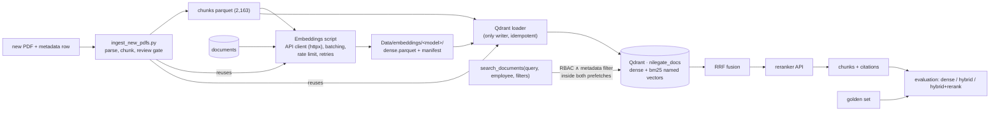

# Plan — RAG retrieval: embeddings (API), Qdrant hybrid search, RBAC, reranking, evaluation

- **Status:** APPROVED (2026-09-28), decisions D1–D8 answered by the owner (§4, "Answers"). **Rewritten 2026-10-01**
  as a fresh start: every phase is a script (ADR-036), the work runs **on the owner's machine** (not a cloud session),
  nothing of Phase 0 counts as done, and a new Phase 8 adds the **PDF ingestion script** for future documents of the
  RAG corpus (moved here from `docs/plans/Scripts_and_ingestion_plan.md` part B, owner decisions D5–D6 of that plan).
  The rewrite needs the owner's confirmation at the start of Phase 0 (D9–D11 are new). Handoff: §"Progress / deviations"
  below, committed.
- **Goal:** turn the 2,163 reviewed chunks into a searchable, access-controlled **hybrid** index (dense + BM25) with an
  optional reranking stage, **prove with numbers** that the right chunks come back for the right user, and leave a
  one-shot script that takes any new PDF of the corpus through the same path (parse → chunk → register → embed → Qdrant). This builds
  the `search_documents` tool of `docs/RETRIEVAL_FLOW.md`; the Supervisor, the other tools and answer generation come
  in the agents phase.
- **Follows** the ROADMAP ingestion order: … → chunking ✅ → embedding model → Qdrant (local Docker) → collection → small
  controlled subset → retrieval test → metadata filtering → RBAC → scale → hybrid / reranking **measured, not assumed**.
- **Builds on:** ADR-001 (Qdrant), ADR-006 (RBAC rule), ADR-009 (payload = chunk columns + `document_id`), ADR-021
  (level per chunk), ADR-027 (container pattern), ADR-031 pattern (files first, one writer, idempotent), ADR-034
  (read-only PostgreSQL user), ADR-035 (`documents`).
- **Answers:** ARCHITECTURE §10 Q1 (embedding model).
- **Design reference:** `docs/RETRIEVAL_FLOW.md` (whole question flow, the document tool, question types → tools, stack research).

---

## 1. Starting point (verified 2026-09-28; pipelines are scripts since 2026-10-01)

| Input | State |
|---|---|
| Chunks `Data/processed/rag/chunks/*.parquet` | 7 files, 2,163 chunks, 16 columns, unique `chunk_id`; 0 empty / duplicate / over-2,000-char texts; median 649 chars (≈ 0.35 M tokens in total) |
| Access columns | `sensitivity_level` 1 (2,158) / 3 (5, HbR financial results, Finance); every `department` is a row of `departments` |
| `documents` (PostgreSQL) | 29 rows; chunk `filename` → `document_id` (basename unique) |
| RBAC data | `roles`, `employees`, `docs/rbac_mapping.md`; read-only login user (`PG_RO_*`) verified 8/8 |
| Infrastructure | `ports-postgres`, `ports-mongo` (127.0.0.1 only); no Qdrant yet; `Data/embeddings/` empty; `httpx` 0.28.1 and `qdrant-client` 1.19.1 already in `pyproject.toml` (to re-check in Phase 0) |
| API keys | `JINA_API_KEY`, `VOYAGE_API_KEY`, `GEMINI_API_KEY` to be in the owner's local `.env`; **no provider tested yet** |
| Code | the 7 per-source chunking scripts (`pipelines/scripts/rag/`) are the reference parsers for Phase 8 |
| Language | corpus in English; questions in Egyptian Arabic and English → cross-lingual retrieval is the main quality risk |

## 2. Target shape



- **Collection `nilegate_docs`:** one point per chunk, point id = UUID5(`chunk_id`) (idempotent). Named vectors:
  `dense` (model dimension, cosine) and `bm25` (sparse, IDF modifier). Both are created from the start, so hybrid never
  needs a rebuild.
- **Payload:** the 16 chunk columns + `document_id`. Payload indexes: `sensitivity_level` (integer); `department`,
  `document_id`, `document_type`, `source`, `real_or_synthetic` (keyword).
- **RBAC inside the query (ADR-006):** `sensitivity_level ≤ ceiling` OR (`department = user department` AND
  `sensitivity_level ≤ 2`), applied in **each** prefetch.
- **Files first:** dense vectors are computed once through the API into `Data/embeddings/` with a manifest (provider,
  model, version / date, dimension, task parameters, chunk hashes). Re-embedding happens only if the model or a chunk
  changes; the loader never calls the embedding API. This protects the free quota and keeps loads reproducible.

## 3. Phases

Every script follows `script-dev-loop` (ADR-036: percent-format cells, `tools/run.py`), a validation cell with a
reviewed snapshot per phase, and a Final Checkpoint (narrative in `pipelines/checkpoints/retrieval/`). New scripts go in
`pipelines/scripts/retrieval/`. Code that Phase 8 reuses (embedding client, Qdrant upsert, chunk schema check) is
written once in a small shared module `pipelines/lib/` (decision D11) instead of being copied. Everything runs on the
owner's machine; the assistant runs `uv` and the scripts there, the owner runs git and edits `.env` (D8).

### Phase 0 — Session start, keys, confirmation (local)
- Confirm the rewrite (D9–D11); the handoff lives in §"Progress / deviations" of this plan, committed.
- The owner adds the keys to `.env`: `JINA_API_KEY`, `VOYAGE_API_KEY`, `GEMINI_API_KEY` (accounts at the three
  providers) and `QDRANT_API_KEY` — **not an account**: a random secret the owner generates, which our own local
  container `ports-qdrant` requires on every request (passed as `QDRANT__SERVICE__API_KEY` when the container is
  created, like the MongoDB root password). The names are already in `.env.example`.
- `uv add` (pinned with `==`): `httpx`, `qdrant-client`; `fastembed` only if Phase 3 shows that server-side BM25 is
  not available in the pinned Qdrant.
- Smoke test per provider, script `pipelines/scripts/retrieval/Provider_smoke_test.py` (one tiny embed call per
  provider + one Jina rerank call, an English and an Egyptian Arabic sentence; prints status, dimension, latency and
  quota headers if any, **never the key**; a key value is redacted from any error text). All three must pass before
  Phase 1 starts. This also settles the UNCERTAIN points: the Jina free-token amount, Voyage limits without a card,
  Arabic behaviour.

### Phase 1 — Golden set first (before any model runs)
Script `Golden_set.py` → `Data/processed/rag/eval/golden_set.jsonl`.
- 40 English questions written from the chunks, each with its expected `chunk_id`s (1–3) and `document_id`; 24 of
  them also written in Egyptian Arabic with the same expected ids (**paired**, D7) → 64 queries (≈ 62 % / 38 %).
- Written as a user would ask (no copying of distinctive chunk phrases, except in identifier questions), and reviewed
  by the owner before the set is frozen (reviewed snapshot + file hash).
- Every source covered in proportion to its size; the question types of `docs/RETRIEVAL_FLOW.md` §3 (rows 1–3, 5, 9)
  are included.
- ≥ 6 **identifier questions** (circular number, MISLE number, vessel name, LOCODE), which test BM25.
- 8 **RBAC cases** on the level-3 HbR chunks, each paired with the users who must / must not see them.
- Validation: expected ids exist; coverage per source / language / type; no duplicates.

### Phase 2 — Embedding bake-off (APIs, no Qdrant)
Script `Embedding_bakeoff.py`.
- Candidates: Jina `jina-embeddings-v5-text-small`, Voyage `voyage-4`, Gemini `gemini-embedding-2`, each with its
  retrieval task parameters (query vs document).
- Embed all chunks + the golden questions once per candidate (≈ 0.35 M tokens each, within the free tiers). Rank by
  cosine similarity in NumPy.
- Compare recall@5 / recall@10 / MRR — overall, per language (Arabic vs English), per source — plus latency and
  failures.
- Also compare the embedded text: `text` vs `title + "\n\n" + text`.
- Output: the choice → **ADR-037**. The candidates' vectors are kept only as scratch (git-ignored).

### Phase 3 — Qdrant container
- Same pattern as `ports-mongo`: image pinned to an exact version + digest, container `ports-qdrant`, volume
  `ports-qdrant-data`, `127.0.0.1:6333` (REST) and `127.0.0.1:6334` (gRPC) only, API key from `.env`.
- `db/qdrant/README.md` with the commands.
- Probe script, output in `db/qdrant/audit/`: create a test collection with `dense` + `bm25` named vectors, payload
  indexes, a hybrid query with a filter in each prefetch + RRF, server-side BM25 availability; then delete the test
  collection.
- Negative checks: no API key → refused; LAN address → closed.

### Phase 4 — Embed all chunks with the chosen model (files)
Script `Embeddings.py` → `Data/embeddings/<model_slug>/dense.parquet` (`chunk_id`, vector, `text_sha256`) +
`manifest.json`.
- The client batches within the rate limits, retries on 429 / 5xx with backoff, and resumes from a partial file.
- Validation: 2,163 vectors, fixed dimension, finite values, `text_sha256` equals the chunk hash; a re-run skips
  every chunk already embedded (0 API calls).

### Phase 5 — Load Qdrant (the only writer)
Script `Qdrant_loader.py`.
- Verify the manifest against the chunk files; recreate `nilegate_docs`; build the BM25 vectors; upsert in batches.
- **Pilot first:** LPI Methodology (94 chunks), full checks; then all 2,163.
- **Reload and re-validate from Qdrant:** count; every payload equals its chunk row + `document_id`; sampled vectors
  equal the file; payload indexes present; a second load changes nothing.

### Phase 6 — `search_documents` + RBAC + metadata filters
Script `Retrieval.py`: `search_documents(query, employee_id, k=8, filters=None, hybrid=True, rerank=True)`.
- The role ceiling and department come from PostgreSQL through the read-only user.
- Two prefetches (dense, bm25), each with RBAC ∧ metadata filter → RRF → reranker (Jina `jina-reranker-v3.5`, or
  Voyage `rerank-3` per D2) → context shaping (at most 2 chunks per document, parent / neighbour option).
- Returns chunks + citations.
- **RBAC test matrix:** 3 roles × 5 departments × the level-3 questions. The level-3 chunks are returned to the CEO
  only; the filter is asserted to be part of the request (inspected request body), never a post-filter.

### Phase 7 — Evaluation
Script `Evaluation.py`.
- Compare **dense only / hybrid / hybrid + rerank** on the golden set: recall@k, MRR per source / language / type,
  identifier questions separately, latency.
- Error analysis of every miss.
- Default settings chosen by the numbers → **ADR-038** (collection, payload, RBAC filter, hybrid, rerank defaults).
- Results in `Data/processed/rag/eval/results_<date>.json`: the baseline the agents phase must not regress.

### Phase 8 — PDF ingestion script for new corpus documents (one shot, after Phases 0–7)
Script `pipelines/scripts/rag/ingest_new_pdfs.py` — a dedicated PDF agent (PDF only): a new PDF placed in
`Data/raw/unstructured/` goes all the way to Qdrant through the path proven above.
```text
new PDF + its metadata row (required)
  → detect new   : sha256 not in Data/processed/rag/documents.csv (a known file is skipped; a changed file = new version, ADR-035)
  → extract      : PyMuPDF text + layout; OCR (RapidOCR, ADR-025) only for image-only pages, with the OCR cache pattern
  → clean        : repeated headers / footers, hyphenation, page numbers → logical units (headings by font size)
  → dedup        : within the document and against the existing corpus, at unit level, before chunking
  → chunk        : semantic boundaries, MIN 300 / MAX 2000 chars, the 16-column schema (ARCHITECTURE §5)
  → validate     : schema, dtypes, unique chunk_id, cross-source concat with the 2,163 chunks, reload from disk,
                   whole-PDF coverage audit (every line has one disposition)
  → REVIEW GATE  : writes a review report (flagged units, coverage, sample chunks) and stops;
                   `--approve <document_id>` continues
  → register     : row in documents.csv + a generated migration db/migrations/NNN_*.sql (applied by the owner)
  → embed        : the Phase 4 client and model, files first (Data/embeddings/<model>/, resumable)
  → upsert       : the Phase 5 loader code (only writer, idempotent: UUID5(chunk_id)), then a retrieval check:
                   a question written from the new document finds it, and its RBAC level is enforced
```
- **Metadata is never guessed** (D9): `title`, `source`, `document_type`, `department`, `sensitivity_level`,
  `real_or_synthetic`, `version_date`, `source_url` come from `Data/raw/unstructured/_incoming.csv`, one row per new
  file, filled by the owner. A file without a row is listed and skipped; there is no default sensitivity level.
- **Honest limit:** the 7 existing sources each needed source-specific rules and manual review; a generic parser gives a
  correct but plainer result. Hence the review gate and "when unsure, preserve and mark for review". The existing
  per-source scripts stay the reference for their sources; the ingestion script never rewrites their artifacts.
- **Test:** one real public PDF not yet in the corpus (chosen with the owner, D10) goes through end to end; a second run
  on the same file changes nothing (0 new chunks, 0 API calls, 0 upserts).

### Phase 9 — Close
- `documents.ingested_at` filled (generated migration); `verify_readonly.sql` §16 expects 29 ingested.
- ARCHITECTURE §1 / §2 / §5 / §6 / §8 / §10, ROADMAP, `docs/DATA_MAP.md` §6, `docs/RETRIEVAL_FLOW.md` (PROPOSED →
  IMPLEMENTED for the document tool), the project rules stack.
- Plan archived; handoff and `_scratch` emptied; commit commands for the owner.

### Out of scope (next plans)
`query_records`, `query_operations`, `compute_toll`, `web_search`, the Supervisor and the LLM that writes the answer, API,
audit log, observability.

### Risks
| Risk | Mitigation |
|---|---|
| Arabic questions over an English corpus retrieve poorly | multilingual models only; per-language metrics decide the model |
| Free quota or rate limit hit | files-first vectors (each chunk embedded once); batching and backoff; the corpus is small (≈ 0.35 M tokens per model) |
| A provider changes its free tier or model | the manifest records provider / model / date; re-embedding costs ≈ 0.35 M tokens; a second provider is already tested in Phase 2 |
| Level-3 chunks leak | RBAC filter in both prefetches + the test matrix; the reranker only reorders candidates that already passed the filter |
| Golden set biased toward the chosen model | written in Phase 1, before any model runs |
| A new PDF parses badly (layout the generic parser does not know) | review gate before any write to the registry or Qdrant; coverage audit; the owner can route a hard source to its own per-source script |
| A new PDF is uploaded with the wrong access level | no default level: the metadata row is required and shown in the review report before approval |
| Data sent to third parties | corpus = public reports + synthetic data; no employee data embedded; Gemini's free tier trains on inputs (noted in the D1 comparison) |

## 4. Decisions (to answer at session start)

Recommended option first.

- **D1 — Embedding provider / model.** Bake-off of Jina `jina-embeddings-v5-text-small` (recommended default: Arabic
  covered, 1,024 dims, 32K context, the same key covers the reranker), Voyage `voyage-4` (200 M free tokens) and Gemini
  `gemini-embedding-2` (free; free-tier data is used by Google). Pick by recall on the golden set, Arabic weighted.
  *Alternative:* a local open model (no quota; heavy dependency).
- **D2 — Reranker.** Jina `jina-reranker-v3.5` (same key; multilingual listwise) vs Voyage `rerank-3` (200 M free
  tokens), measured in Phase 7; kept only if it improves the metrics. Cohere excluded (trial: 1,000 calls / month,
  10 rerank requests / min).
- **D3 — Vector database.** Qdrant in Docker (`ports-qdrant`, pinned, 127.0.0.1 only, API key) with `dense` + `bm25`
  named vectors from the start. *Alternatives:* Weaviate, Milvus, pgvector (see `docs/RETRIEVAL_FLOW.md` §5).
- **D4 — BM25 source.** Server-side BM25 inference if the pinned Qdrant offers it (checked in Phase 3), otherwise
  `fastembed` `Qdrant/bm25` on the client.
- **D5 — Embedded text.** Decided by the bake-off: `text` vs `title + text`.
- **D6 — Pilot subset.** LPI Methodology (94 chunks) first, then all 2,163.
- **D7 — Golden set.** ~40 questions (≈ 60 % English / 40 % Egyptian Arabic) + ≥ 6 identifier questions + 8 RBAC
  cases.
- **D8 — Working mode.** the assistant runs uv, Docker and the scripts (on the owner's machine); the owner runs git and anything writing `.env`
  (as in the data-processing phase).

- **D9 — Ingestion metadata (new).** A CSV the owner fills (`Data/raw/unstructured/_incoming.csv`) / *or* a YAML
  sidecar next to each PDF.
- **D10 — Ingestion test document (new).** One real public PDF not yet in the corpus, chosen with the owner in Phase 8
  (e.g. a port-authority or IMO document) / *or* a synthetic NileGate PDF.
- **D11 — Shared code (new).** A small `pipelines/lib/` module for the code Phases 4, 5 and 8 share (embedding client,
  Qdrant upsert, chunk schema check) / *or* copy the code into each script (the pre-ADR-036 rule "no `.py` modules").

### Answers (owner, 2026-09-28)
- **D1:** bake-off of all three (Gemini included: the corpus is public reports, no employee data is sent). **Selection
  rule fixed before any model runs:** primary metric = mean of recall@10 on the English and on the Arabic queries
  (equal weight); a difference smaller than two questions' worth (≈ 5 points) is a tie, and a tie goes to Jina (one key
  for embeddings and reranker). MRR, per-source recall, latency and failures are reported, not deciding.
- **D2:** Jina `jina-reranker-v3.5`, kept only if Phase 7 shows a gain; Voyage `rerank-3` as the alternative.
- **D3:** Qdrant in Docker as proposed. **D4:** server-side BM25 if the probe finds it, else `fastembed`.
- **D5:** measured in Phase 2 (note: USCG chunks already start with a header, so `title + text` repeats it there).
- **D6:** LPI Methodology pilot, then all chunks.
- **D7:** 40 English questions + 24 Egyptian Arabic twins of them (same expected ids, 64 queries) + ≥ 6 identifier
  questions + 8 RBAC cases (including a Finance employee: the department never unlocks level 3); owner review before
  freezing.
- **D8:** as proposed; deletions (`Remove-Item`) are blocked by the settings and are listed for the owner.

## Progress / deviations
- 2026-10-01: plan rewritten for a fresh start on the owner's machine (scripts, Phase 8 PDF ingestion, D9–D11). Nothing
  of Phase 0 is done; no provider has been tested. ADR numbers for this plan: ADR-037 (embedding model), ADR-038
  (retrieval defaults).
